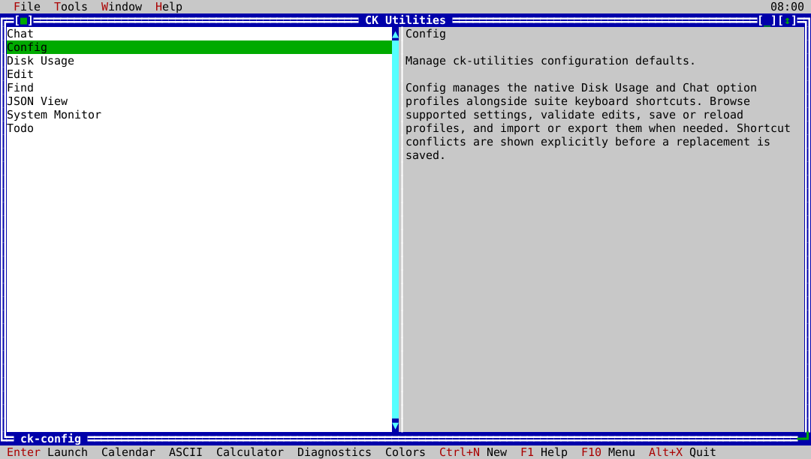

## One launcher, eight tools

Start `ck-utilities` to pick a tool from the launcher, or run any tool
directly: `ck-json-view`, `ck-find`, `ck-du`, `ck-edit`, `ck-chat`,
`ck-todo`, `ck-sysmon`, and `ck-config`. Every tool shares the same menu
bar, window handling, help, and key footer, so what you learn in one works in all of them.

## Start here

1. [Install CK Utilities](installation.md) on macOS or Linux.
2. Open the [launcher](tools/ck-utilities.md) and try a tool.
3. Set up [Chat with a local model](tools/ck-chat.md) if you want AI
   assistance that never leaves your computer.

## Find an answer

| Task | Guide |
|---|---|
| Download, install, or upgrade | [Installation](installation.md) |
| Inspect a JSON file | [JSON View](tools/json-view.md) |
| Search for files by name, content, date, or size | [Find](tools/ck-find.md) |
| See what is using disk space | [Disk Usage](tools/ck-du.md) |
| Write and format Markdown | [Edit](tools/ck-edit.md) and [Markdown commands](markdown-commands.md) |
| Talk to a local model | [Chat](tools/ck-chat.md) |
| Keep track of tasks | [Todo](tools/ck-todo.md) |
| Watch CPU, memory, and GPU load | [System Monitor](tools/ck-sysmon.md) |
| Change settings and shortcuts | [Config](tools/ck-config.md) |
| Build and test the source | [Building from source](building.md) |

## Platforms

CK Utilities runs on macOS and Linux. A Windows version is not available yet.

CK Utilities is free software, provided as-is under the
[GNU General Public License, version 3](https://github.com/cklukas/ckUtilities/blob/master/LICENSE),
without user support or warranty.
