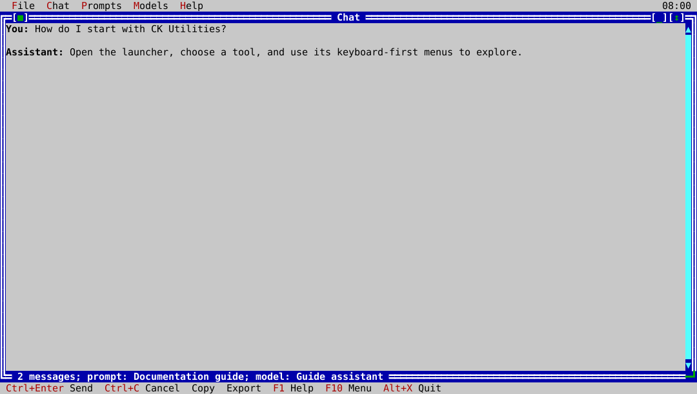

# ck-chat

`ck-chat` is the native terminal interface for the configured local GGUF
model. It loads AI configuration from `~/.config/cktools/ckai.toml`
(`%APPDATA%\cktools\ckai.toml` on Windows), lets you
manage models and system prompts, streams and cancels responses, and exports
conversations from the interactive application.



A missing or unusable model is shown as an error in the transcript. The
product never silently falls back to a deterministic test response.

## Features

- Local GGUF model discovery, selection, activation, download state, and
  hardware/context/output settings from the user-owned configuration file.
- Named system prompts with create, edit, activate, restore-default, and safe
  validation workflows.
- Streaming responses, cancellation, bounded transcript rendering, clear
  model errors, and explicit busy/running state.
- Conversation transcript export, Markdown-aware rendering when enabled, and
  keyboard-first menus for models, prompts, settings, help, and exit.
- No network model fallback or fake response is substituted when the selected
  local model is missing or unusable.

## Usage

```bash
ck-chat
```

Copy `configs/ckai.example.toml` to `~/.config/cktools/ckai.toml`
(`%APPDATA%\cktools\ckai.toml` on Windows) and set a
valid local GGUF path before sending a response. Use `ck-chat --help` for the
command-line synopsis; prompts are entered through the native interface.
