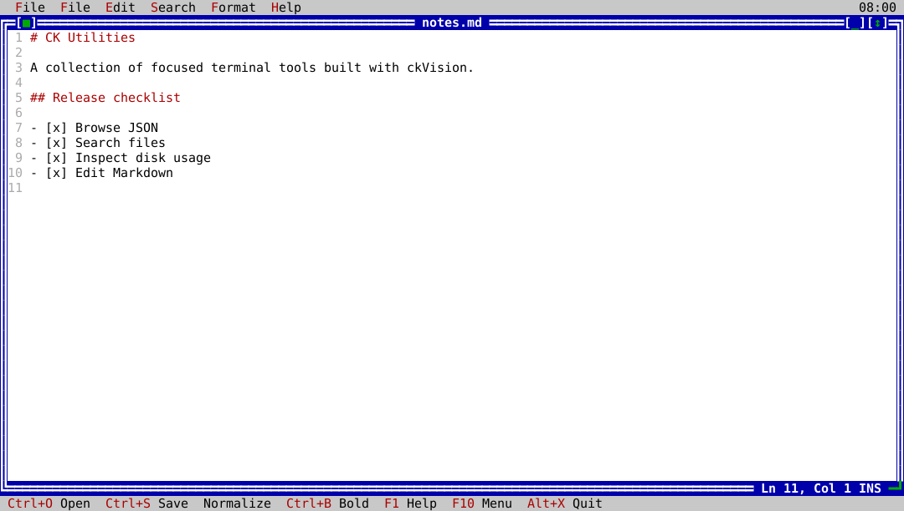

# ck-edit

`ck-edit` is the native ckVision Markdown editor. It supports safe file
editing, Markdown transformations, search and replacement, and configurable
keyboard shortcuts.



## Usage

```text
ck-edit [MARKDOWN_FILE]
```

Pass a Markdown file to open it at startup, or use **File → Open document**.
Use `--help` (or `-h`) to show the command-line usage, or `--version` to print
package metadata without opening the editor.

## Features

- Open, save, save as, close, and switch Markdown documents with explicit
  Save, Discard, or Cancel choices for dirty content.
- Undo and redo every supported mutation, viewport-only word wrap, find,
  replace, and replace-all.
- Normalize whitespace and reflow paragraphs; format selections; edit
  headings, tasks, quotes, lists, links, images, and footnotes.
- Create and edit pipe tables, including one-step undoable row and column
  insertion or removal.
- Detect external changes and preserve both versions when local edits are
  unsaved, requiring an explicit reload, Save As, or continue decision.
- Shared menus, keyboard shortcuts, help, themes, status feedback, and safe
  bounded file I/O.

## Native workflow

- **File:** open, save, save as, and close documents. Dirty documents require
  an explicit Save, Discard, or Cancel choice.
- **Edit:** undo, redo, toggle viewport-only word wrap, find, replace, and
  replace all.
- **Markdown:** normalize whitespace, reflow paragraphs, format selected text,
  manage headings, tasks, quotes, and lists, and insert or remove links,
  images, and footnotes. Create pipe tables and add or delete table rows and
  columns through one-step, undoable Markdown transactions.

If an open file changes outside the editor while it has local unsaved edits,
`ck-edit` preserves both versions and requires an explicit Save As,
reload/discard, or continue-editing decision.

See [Markdown command details](../markdown-commands.md) for the native
transformation behavior and safety rules.
