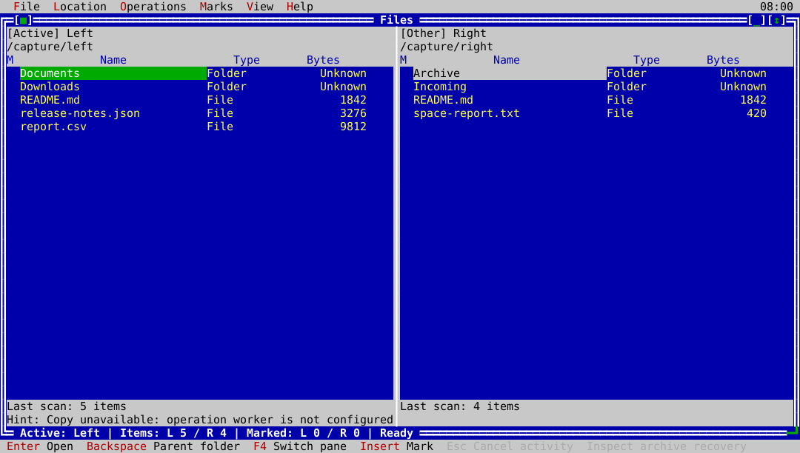
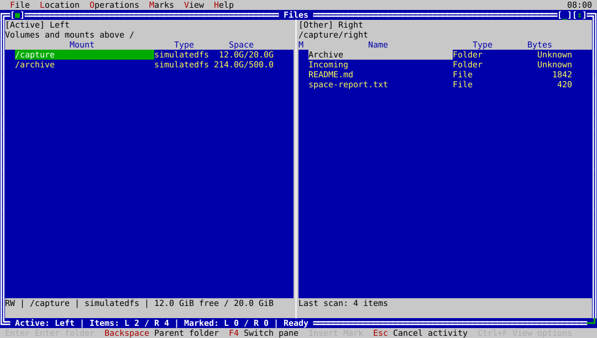

# ck-files

`ck-files` is the CK Utilities two-pane file manager, designed for the fast
location-to-location workflow of Norton Commander and Midnight Commander while
keeping every mutating operation reviewed and capability-checked.



At a filesystem namespace root, **Backspace** opens the read-only volume and
mount view in that pane, shown below. It is a system-information view, not a
writable parent directory.



## Usage

```text
ck-files [LEFT_DIRECTORY [RIGHT_DIRECTORY]]
```

Without arguments, both panes start from the current directory. Use
`--help` (or `-h`) for the command-line synopsis. The application does not
execute files or provide an embedded shell.

## Features

- Two independent panes with an explicit active-pane indicator, resizable
  layout, narrow-terminal fallback, location fields, breadcrumbs, history,
  bookmarks, parent/home/root navigation, and Windows drive/UNC entry.
- At a namespace root, pressing **Backspace** once replaces that pane's file
  rows with a read-only volume and mount listing above the normal filesystem
  boundary. Mount shows the mount/drive name; Type shows the filesystem format;
  Space shows free and total capacity together. The selected row's footer adds
  its mount, filesystem, space, and read-only state. The view uses
  ordinary read permissions and never exposes volume rows as operation targets.
  Copy starts a separate Volume archive planning/review worker only after
  native identity, live-read capability, destination, and private-journal
  checks pass. It remains visibly disabled otherwise, with the specific reason
  in the active-pane status. Approval creates a versioned sparse filesystem
  archive, not a raw block image; Move is never used for this operation. The
  review shows consistency, logical/data bytes, sparse shape, links, and
  explicit preservation losses. The worker revalidates the source, records
  durable journal states, verifies data before no-replace publication, and
  reports indeterminate durability when publication has happened but a later
  flush or journal step cannot be proven. On startup, a bounded read-only
  recovery scan checks private archive journals; Copy remains disabled until
  the scan is complete and no reconciliation-required journal is present.
  Snapshot providers remain capability-gated. **Inspect archive recovery** is
  available as a bounded, read-only review of matching journals. A separate
  worker boundary refuses restart cleanup because the original archive
  creator's live ownership is unavailable. **Clean up archive staging** stays
  disabled with that reason; journal names and matching content cannot grant
  deletion authority. Resume/retry/publication remain unavailable. See the [volume archive
  plan](https://github.com/cklukas/ckUtilities/blob/master/implementation/ck-files-volume-archive-plan.md).
- Asynchronous directory loading with completion, bounded results, refresh,
  folders-first display, sorting by name/type/size/date, hidden-item toggle,
  and quick filename filtering.
- Keyboard and mouse navigation, focused-row identity, mark/unmark, range
  selection, select all, invert, clear selection, and an always-visible exact
  source count for operations.
- Bounded read-only text and hexadecimal preview, properties, and path copy.
  Preview never runs a file, hydrates provider-managed content implicitly, or
  treats a display name as a rewritten native path.
- Rename, create-folder, create-empty-file, hard-link, and qualified symbolic-link actions with strict name validation. New files are created exclusively relative to the held pane directory, flushed before success, and followed by an acknowledged listing refresh; duplicate names are refused as a changed destination. Hard links are regular-file-only, identity-bound, no-replace mutations, flushed before success, and currently target the selected file's pane. POSIX symbolic links store an opaque target without normalization or traversal; Windows keeps this command disabled until handle-relative reparse publication is qualified. **Inspect link target** reads bounded POSIX link or Windows reparse metadata from the held object without following or executing it; opaque Windows payloads remain explicitly opaque. Case-only
  renames and platform-specific name rules are capability-checked rather than
  silently normalized.
- Copy and move planning that shows the exact sources, destination, conflicts,
  metadata/stream preservation, unresolved risks, and expected losses before
  execution. Conflict choices are scoped to the reviewed job.
- Cancellable worker-owned jobs with honest progress, per-item outcomes,
  source/destination identity revalidation, durable journal boundaries, and
  explicit committed, retained, skipped, failed, and indeterminate results.
- Same-filesystem moves use identity-bound native rename when qualified.
  Cross-filesystem moves use copy, independent stream verification, durable
  destination publication, and only then qualified source retirement.
  Recursive trees use the same safety model and never follow links or silently
  include children that appeared after planning.
- A separate **Move to Trash / Recycle Bin** action and confirmation. It uses
  the native platform boundary where qualified, including identity-checked
  directory trees on the native filesystem; unsupported or uncertain behavior
  retains the source and reports the reason instead of falling back.
- A separate **Inspect operation recovery** review scans ordinary copy, tree
  copy, move, and recursive-delete journals after startup. It is read-only:
  malformed, truncated, legacy, ambiguous, or untrusted records remain
  visible as reconciliation items. **Clean up operation staging** is disabled
  for recovered journals: cleanup requires the originating copy worker's live
  ownership of the created staging object. Reopened journal IDs and names do
  not provide that authority. No resume, retry, replacement, publication, or source retirement
  is offered without a later qualified worker boundary. Ordinary-copy journals
  also retain the independently verified whole-file SHA-256 receipt at the
  Copied and Verified boundaries; it is used for future reconciliation only,
  never as pathname-based authority. A worker-only read-only verifier can
  independently rebind the destination parent and check the published object
  identity, length, and content digest; it does not expose a mutation or
  recovery command.
- A separate irreversible **Delete permanently** action with explicit scope
  confirmation and identity-bound checks. It does not follow links, recurse
  through non-empty directories, or claim secure erasure.
- Preservation and capability reporting for data streams, extended
  attributes, permissions and ACLs, ownership, timestamps, flags, links,
  sparse/compressed storage, names, provider-managed objects, and filesystem
  boundaries. Unknown or unavailable preservation is a reason to stop, skip,
  or choose another destination—not a silent success.
- Shared suite help, themes, configurable shortcuts, visible menu alternatives,
  durable display settings and exact native bookmarks, and CLI
  help/version behavior. Settings are versioned, bounded, private and written
  atomically in the background. Rapid changes save the latest complete state;
  quitting drains accepted changes before exit. Invalid settings and failed or
  conflicting writes are reported. An uncertain save is not reported as saved
  or blindly retried; any final save error prints after the Files screen closes.

## Default commands

| Key | Action |
|---|---|
| Enter | Enter a directory or preview a file |
| Space | Mark or unmark the focused entry |
| Backspace | Go to the parent directory |
| Ctrl+L | Edit the location |
| F3 | Preview |
| F5 | Copy |
| F6 | Move |
| F7 | Create folder |
| Operations menu | Create empty file |
| Operations menu | Create hard link |
| Operations menu | Create symbolic link (qualified POSIX adapters) |
| Operations menu | Inspect link target (qualified link/reparse rows) |
| F2 | Rename |
| Ctrl+R | Refresh |
| F1 | Context help |
| Alt+X | Quit |

`Operations > Inspect archive recovery` and `Operations > Inspect operation
recovery` open bounded read-only reviews when their startup scans find matching
journals. `Operations > Clean up archive staging` and `Operations > Clean up
operation staging` remain disabled for restart inspection because live ownership
of the originally created object is required. Their unavailable reasons appear
in the command status. The inspect actions never resume, delete, replace, retry,
or retire a source.
  New archive journals retain the exact destination address in native
  encoding for future identity-bound reconciliation; legacy journals without
  that evidence remain inspect-only.

All actions also have visible menu or dialog commands, and shortcut bindings
can be reviewed through the suite configuration UI. Completion retains
ckVision's Right-to-accept behavior. If folder completion fails, the location
dialog shows a short reason, including access denial or a completion limit.
The entered address and both panes stay unchanged. Editing the address clears
the previous warning; a successful proposal can still be accepted with Right.

## Platform qualification and safety boundary

The Files implementation is cross-platform and refuses unsupported operations
explicitly. Current qualification records document the exact platform matrix:
Windows has qualified Recycle Bin moves for regular files and directory trees;
macOS and Linux qualify same-device native Trash transactions with restore
metadata, and the mount-specific paths are qualified on macOS against a
write/search-only `.Trashes` root and on Linux against a foreign `/dev/shm`
volume. POSIX permanent source-retirement remains explicitly unsupported. The
current macOS terminal verifier has
qualified `Alt+X`, resize, and terminal-mode restoration for xterm-256color,
xterm, and vt100; the Windows ConPTY contract has qualified launch, drawing,
and clean `Alt+X` shutdown for the installed utility set. The same three
profiles pass for all ten utilities in the Linux aarch64 archive. This is still
an implementation checkpoint, not a claim that every release gate is complete:
recovery execution, full filesystem-matrix coverage, and final
mouse/restricted-key acceptance remain tracked work. Volume archive live
traversal is focused-qualified on the three build platforms; native snapshot providers,
archive restart reconciliation, and real-volume interactive archive fixtures
remain open release gates.

The operation plan is not a global transaction and does not promise rollback
after a partial failure. Cancellation stops new work at a safe boundary and
reports completed effects. Recovery verifies identities and journals before
offering inspect, cleanup, or revalidated retry; it never automatically
deletes an artifact or source by pathname.

See the [Files implementation plan](https://github.com/cklukas/ckUtilities/blob/master/implementation/ck-files-plan.md),
[contracts](https://github.com/cklukas/ckUtilities/blob/master/implementation/ck-files-contracts.md), and
[qualification evidence](https://github.com/cklukas/ckUtilities/blob/master/implementation/ck-files-progress.md) for the
precise guarantees and remaining release gates.
