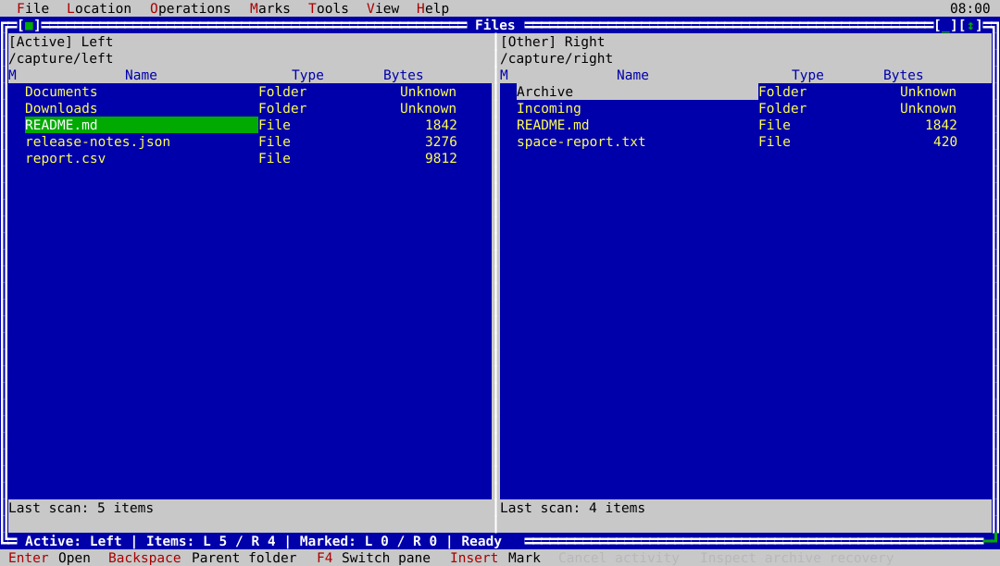
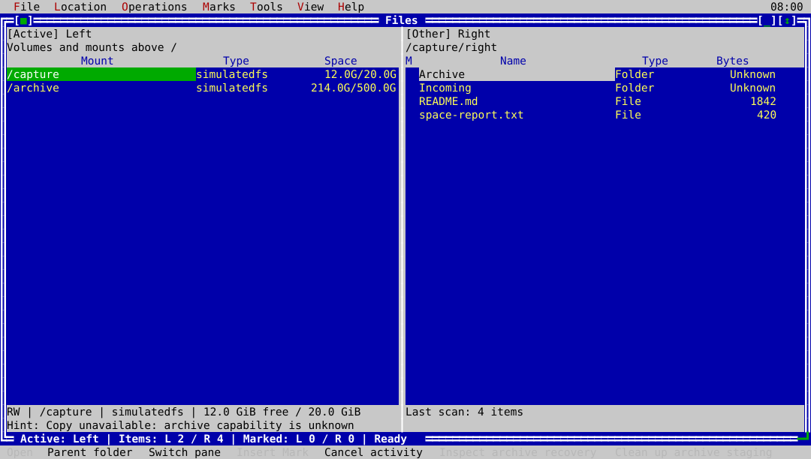
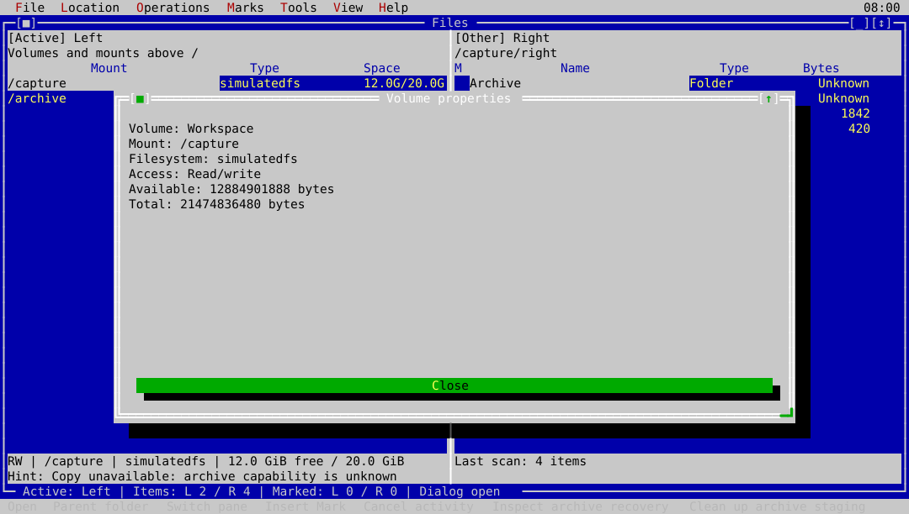

# ck-files

`ck-files` is the CK Utilities two-pane file manager, designed for the fast
location-to-location workflow of Norton Commander and Midnight Commander while
keeping every mutating operation reviewed and capability-checked.



At a filesystem namespace root, **Backspace** opens the read-only volume and
mount view in that pane, shown below. It is a system-information view, not a
writable parent directory.



**Location → Properties** displays the selected mount's exact capacity.



## Usage

```text
ck-files [LEFT_DIRECTORY [RIGHT_DIRECTORY]]
```

Without arguments, both panes start from the current directory. Use
`--help` (or `-h`) for the command-line synopsis. The application does not
execute files or provide an embedded shell.

On Linux and macOS, put `--osc52-clipboard` before the directory arguments
when your terminal permits OSC 52 clipboard writes. Without the option,
copied paths stay in the Files clipboard. On Windows, Files uses the native
clipboard.

## Features

- Two independent panes with an explicit active-pane indicator, resizable
  layout, narrow-terminal fallback, location fields, breadcrumbs, history,
  bookmarks, parent/home/root navigation, and Windows drive/UNC entry.
- A known read-only mount disables commands that would change it and shows the
  reason in the active pane. Navigation, preview, and marking remain available.
  You can copy from a read-only mount to a writable destination.
- At a namespace root, pressing **Backspace** once replaces that pane's file
  rows with a read-only volume and mount listing above the normal filesystem
  boundary. Mount shows the mount/drive name; Type shows the filesystem format;
  Space shows free and total capacity together. The selected row's footer adds
  its mount, filesystem, space, and read-only state. Long labels end in an
  ellipsis. In narrow panes, Space and then Type give way to the Mount column.
  **Location → Properties** shows the full selected mount, filesystem, access
  state, and exact available and total bytes. It identifies values retained
  from the last successful scan if a refresh fails.
  The view uses
  ordinary read permissions and never exposes volume rows as operation targets.
  Windows lists volumes without a drive letter or folder mount by volume GUID.
  **Refresh** updates that pane's volume list and checks for archive recovery
  records. It keeps the selected mount when it can match it after refresh.
  **Esc** cancels a pending scan. During a refresh, the previous volume rows
  stay visible until a later refresh succeeds.
  You can keep browsing in the other pane while the volume list loads.
  If reopening the filesystem root fails or you cancel it, the selected
  volume stays visible.
  If the volume list cannot be refreshed, the previous values stay visible
  and Copy stays disabled until a refresh succeeds.
  Copy starts volume archive planning on the archive worker only after
  native identity, live-read capability, destination, and private-journal
  checks pass. It remains visibly disabled otherwise, with the specific reason
  in the active-pane status. A read-only destination mount disables Copy.
  The archive worker checks the mount again before writing. Approval creates a
  versioned sparse filesystem archive with a manifest and file data. The
  worker holds the captured data in private, unnamed scratch storage while
  you review it. That storage needs room for the captured data extents until
  the archive has been written to its destination staging file. The
  review shows consistency, logical/data bytes, sparse shape, links, and
  explicit preservation losses, including ACLs and extended attributes.
  Open **Review losses** to browse the full list. **Details** or **Enter**
  shows the exact path and explanation for the selected row. **Acknowledge**
  records its acceptance, and **Back** returns to the archive summary. Files
  requires acknowledgement of every listed loss before creation.
  During creation, the pane footer shows the bytes written and then the
  bytes read back for verification. Verification covers the entire logical
  archive, including its sparse holes. **Esc** requests cancellation. The
  footer reports the outcome after the worker finishes.
  Live archive creation has passed native Linux ext4, XFS, and Btrfs
  fixtures. On macOS, volume browsing is available and archive Copy stays
  disabled pending support for exact archive publication.
  Changing focus during planning keeps the
  reviewed source and destination panes. The worker keeps the source mount
  root and destination directory open through approval. If either was
  replaced or the archive name was taken, Files asks for a new review.
  Live capture also stops when it observes a file or directory change while
  reading the source. A new review builds a fresh capture.
  After confirmed publication, Files displays the result in the original
  destination pane and refreshes it when the pane still shows that directory.
  The worker verifies the archive data, checks both routes again, and
  publishes through the held folder. If the folder moves during publication,
  Files displays the path only if it can verify the reviewed location. Files
  reports indeterminate durability when a flush or journal step after
  publication cannot be proven. If storage fills or a quota is reached before
  publication, the pane status reports that failure. On startup and after each
  archive attempt, a bounded read-only scan checks private archive journals through the held
  journal directory and reports if that directory was replaced. Each attempt has its own journal ID, so completed records
  remain available when Files restarts. Copy remains disabled until the scan
  completes and no journal needs reconciliation. At approval, the archive
  worker checks recovery again and uses the same inspected directory for the
  new journal.
  Snapshot providers remain capability-gated. **Inspect archive recovery** is
  a read-only list of every journal in the latest scan, with journals needing
  review at the top. **Details** or **Enter** opens the selected journal's
  recorded source and destination, state, and required action. A separate
  worker boundary refuses restart cleanup because the original archive
  creator's live ownership is unavailable. **Clean up archive staging** stays
  disabled with that reason. Restart records are available for inspection
  only. See the [volume archive
  plan](https://github.com/cklukas/ckUtilities/blob/master/implementation/ck-files-volume-archive-plan.md).
- Asynchronous directory loading with completion, bounded results, refresh,
  folders-first display, sorting by name/type/size/date, hidden-item toggle,
  and quick filename filtering. **Ctrl+R** keeps the cursor and marks on
  entries whose identity Files can still verify. The pane footer reports lost
  marks and a lost cursor binding. Update or clear the marks before starting
  Copy or Move. Choose **Marks → Use current row** to confirm
  the row under the cursor if its previous binding was lost.
  Copy and Move use the marked entries when marks are present. Reveal or clear
  marks hidden by a filter to enable either command.
- Keyboard and mouse navigation, focused-row identity, mark/unmark, range
  selection, select all, invert, clear selection, and an always-visible exact
  source count for operations.
- Bounded read-only text and hexadecimal preview, properties, and path copy.
  **Enter** or **F3** reads up to 64 KiB from the selected regular file.
  A valid UTF-8 preview opens as text with **Show hex** available. Binary or
  unsafe text opens as hex. The footer identifies a partial preview.
  **Location → Copy path** copies the focused entry's absolute path. A native
  name that cannot be expressed as ordinary path text uses the reversible
  **Exact Names** format from the location editor. Files reports whether the
  system clipboard accepted the copy or the terminal received a request.
- Rename, create-folder, create-empty-file, hard-link, and qualified symbolic-link actions with strict name validation. New files are created exclusively relative to the held pane directory, flushed before success, and followed by an acknowledged listing refresh; duplicate names are refused as a changed destination. Hard links are regular-file-only, identity-bound, no-replace mutations, flushed before success, and currently target the selected file's pane. POSIX symbolic links store an opaque target without normalization or traversal; Windows keeps this command disabled until handle-relative reparse publication is qualified. **Inspect link target** reads bounded POSIX link or Windows reparse metadata from the held object without following or executing it; opaque Windows payloads remain explicitly opaque. Case-only
  renames and platform-specific name rules are capability-checked rather than
  silently normalized.
- Press **Esc** to cancel while Files prepares a copy or move plan. The review
  shows **From**, **To**, and the selected entry count once planning finishes.
  A plan is capped at 1,024 entries, counting the selected folder and its
  descendants. The operating system may reach its open-file limit sooner
  because the review holds an identity handle for each source and shares the
  process's open-file allowance with directory scans and both panes.
  Open **Paths and names** to scroll through the full paths and every selected
  name. The review identifies the source files affected by conflicts or
  preservation losses. For a batch of individual files, **Keep existing
  targets and skip conflicts** leaves the occupied targets and their sources
  in place. Files transfers the other items once you acknowledge their listed
  losses. You can acknowledge all listed losses with one checkbox.
  **Keep both with reviewed names** gives each incoming file a new name in
  the receiving pane and keeps the existing target. Files checks the new
  names against the destination before writing. Publication uses the
  filesystem's no-replace operation if a name becomes occupied during transfer.
  **Choose another destination** opens the location editor for the receiving
  pane. Files asks for a fresh review if the approved transfer changes.
  Copying a folder onto an existing folder of the same name opens a review of
  their contents. The merge preserves destination-only files. The worker
  offers **Use source** and **Use newest** for regular-file conflicts when it
  can verify target retention. **Use newest** keeps the target when times tie.
  Set one decision for the folder and override it for individual conflicts.
  Previous versions appear in **Operation recovery**.
- Cancellable worker-owned jobs with honest progress, per-item outcomes,
  source/destination identity revalidation, durable journal boundaries, and
  explicit committed, retained, skipped, failed, and indeterminate results.
- Same-filesystem moves use identity-bound native rename when qualified.
  Cross-filesystem moves use copy, independent stream verification, durable
  destination publication, and only then qualified source retirement (using
  Linux `F_SETLEASE` / Windows `FILE_SHARE_READ` exclusion plus live metadata
  stability verification; modified, hard-linked, or unqualified sources remain
  retained). Non-sync UI Copy/Move operations also acquire cross-process root
  leases when source and destination roots are disjoint, blocking competing
  processes cleanly. Tree operations never follow links or silently include
  new children.
- **Move to Trash / Recycle Bin** (**F8**) confirms the selected entry (or all
  marked entries, including directories) and revalidates each identity on the
  worker. An unsupported entry stays in place, and an uncertain outcome is
  reported for review.
- **Inspect operation recovery** shows a read-only scan of copy, move, and
  recursive-delete journals. The scan runs at startup and after file operations.
  Interrupted moves with exact name receipts show their source and destination
  names. The review also reads replacement-retention journals in that folder
  and shows the original target name, the recorded or proposed retained name,
  and the recorded destination folder when available. Malformed, truncated,
  legacy, ambiguous, or untrusted records remain
  visible as reconciliation items. From **Operation recovery review**, Files
  exposes worker-owned **Resume recorded job**, **Retry unresolved items**,
  **Restore retained version**, and **Dispose retained version** actions, which
  re-inspect the journal from the private root, verify live parent and object
  identities (parking any colliding destination safely during restore), execute
  the linked transfer/retirement or retention action, and retire the resolved
  journal. **Clean up operation staging** remains disabled for standalone
  restart inspection because live creator ownership is required. When a Copy
  or Move overlaps an unfinished, retained-source, or untrusted operation
  journal by native source or destination identity—even after a rename—planning
  and execution hold the transfer and open **Reconciliation required** instead
  of bypassing the unresolved record, displaying the backend's reconciliation
  disposition, per-item review classification, and retry-lineage status.
  Ordinary-copy journals
  also retain the independently verified whole-file SHA-256 receipt at the
  Copied and Verified boundaries; it is used for future reconciliation only,
  never as pathname-based authority.
- **Delete permanently** (**Shift+F8**) requires an explicit confirmation and
  supports individual entries, directories (including recursive directory
  deletion on Windows, macOS, and Linux), and batches of marked entries.
  Directory deletion reviews a frozen inventory and revalidates each entry
  before removal, preserving links as boundaries and keeping children that
  appeared after review.
- Preservation and capability reporting for data streams, extended
  attributes, permissions and ACLs, ownership, timestamps, flags, links,
  sparse/compressed storage, names, provider-managed objects, and filesystem
  boundaries. Unknown or unavailable preservation is a reason to stop, skip,
  or choose another destination—not a silent success.
- Shared suite help, themes, configurable shortcuts, visible menu alternatives,
  durable display settings and exact native bookmarks, and CLI
  help/version behavior. Settings are versioned, bounded, private and written
  atomically in the background. Rapid changes save the latest complete state;
  quitting drains accepted changes before exit. Invalid settings and failed or
  conflicting writes are reported. An uncertain save is not reported as saved
  or blindly retried; any final save error prints after the Files screen closes.

Saved settings larger than 1 MiB remain unchanged. Files starts with defaults;
changes stay in memory, and a final save error is reported after the screen
closes. Startup reading uses the same opened file for its bytes and revision.

## Default commands

| Key | Action |
|---|---|
| Enter | Enter the selected directory or preview the selected file |
| Insert | Mark or unmark the focused entry |
| Backspace | Go to the parent directory, show volumes at a namespace root, or leave the volume view |
| Ctrl+L | Edit the location |
| Right | Accept the location editor's current completion proposal |
| Ctrl+F | Open view options |
| F3 | Preview |
| F4 | Switch panes |
| F5 | Copy |
| F6 | Move |
| F7 | Create folder |
| F8 | Move to Trash / Recycle Bin (single, directory, or marked batch) |
| Shift+F8 | Delete permanently (single, recursive directory, or marked batch) |
| F2 | Rename file or folder |
| Shift+F2 | Compare directories |
| Ctrl+U | Swap panes |
| Alt+I | Open active folder in other pane |
| Marks menu | Mark / Unmark by pattern |
| Esc | Cancel the current activity or dismiss the dialog |
| Operations menu | Create empty file |
| Operations menu | Create hard link |
| Operations menu | Create symbolic link (qualified POSIX adapters) |
| Operations menu | Inspect link target (qualified link/reparse rows) |
| Operations menu | Resume recorded job / Retry unresolved items / Restore or Dispose retained version |
| Ctrl+R | Refresh |
| F1 | Context help |
| Alt+X | Quit |

Use **Alt+O** to open Operations and **Alt+L** to open Location without
function keys. Under **Location**, use **Add bookmark** (**D**) to save the active
pane's location and **Open bookmark** (**K**) to choose one of that pane's saved
locations. Highlight an unavailable menu command or click its disabled
footer action to see the reason in the active pane. **View > Commands** opens
the command palette, where you can also highlight a disabled match to see
its reason. In the volume view, press **Backspace** to return to the
filesystem listing.

While Files is reading or checking storage, including for location completion,
**Quit** offers **Stay** or **Stop activity and exit**. Completed changes remain
in place. Stopping may wait for storage to respond.

`Operations > Inspect archive recovery` and `Operations > Inspect operation
recovery` open bounded read-only reviews when their startup scans find matching
journals. `Operations > Clean up archive staging` and `Operations > Clean up
operation staging` remain disabled for restart inspection because live ownership
of the originally created object is required. Their unavailable reasons appear
in the command status. The inspect actions never resume, delete, replace, retry,
or retire a source.
  New archive journals retain the exact destination address in native
  encoding for future identity-bound reconciliation; legacy journals without
  that evidence remain inspect-only.

All actions also have visible menu or dialog commands, and shortcut bindings
can be reviewed through the suite configuration UI. Completion retains
ckVision's Right-to-accept behavior. If folder completion fails, the location
dialog shows a short reason, including access denial or a completion limit.
The entered address and both panes stay unchanged. Editing the address clears
the previous warning; a successful proposal can still be accepted with Right.

## Platform qualification and safety boundary

The Files implementation is cross-platform and refuses unsupported operations
explicitly. Current qualification records document the exact platform matrix:
The backend has qualified Windows Recycle Bin moves for regular files and
directory trees. Backend macOS and Linux qualification includes same-device
native Trash transactions with restore metadata, plus a write/search-only
`.Trashes` root on macOS and a foreign `/dev/shm` mount on Linux. Files offers
Trash for supported individual entries and has no in-app Restore action. The
current macOS terminal verifier has
qualified `Alt+X`, resize, and terminal-mode restoration for xterm-256color,
xterm, and vt100; the Windows ConPTY contract has qualified launch, drawing,
and clean `Alt+X` shutdown for the installed utility set. The same three
profiles pass for all ten utilities in the Linux aarch64 archive. A Linux
terminal run copied a private ext4 mount into a sparse archive and verified the
reconstructed file against the source hash. On macOS, Files disables volume
Copy because the native archive writer lacks a qualified publication route.
Native snapshot providers, archive restart reconciliation, and the remaining
filesystem and desktop acceptance checks are still in qualification.

The operation plan is not a global transaction and does not promise rollback
after a partial failure. Cancellation stops new work at a safe boundary and
reports completed effects. Process-crash recovery (`SIGKILL` / `TerminateProcess`
at copy-staging and move-journal boundaries) and kernel I/O fault handling
(`ENOSPC`, read-only mounts, and Linux `dm-error`/`dm-flakey` tests) are
qualified separately from host power-loss guarantees; universal losslessness is
never claimed. Recovery verifies identities and journals before offering
inspect, cleanup, or revalidated retry; it never automatically deletes an
artifact or source by pathname.

See the [Files implementation plan](https://github.com/cklukas/ckUtilities/blob/master/implementation/ck-files-plan.md),
[contracts](https://github.com/cklukas/ckUtilities/blob/master/implementation/ck-files-contracts.md), and
[qualification evidence](https://github.com/cklukas/ckUtilities/blob/master/implementation/ck-files-progress.md) for the
precise guarantees and remaining release gates.
