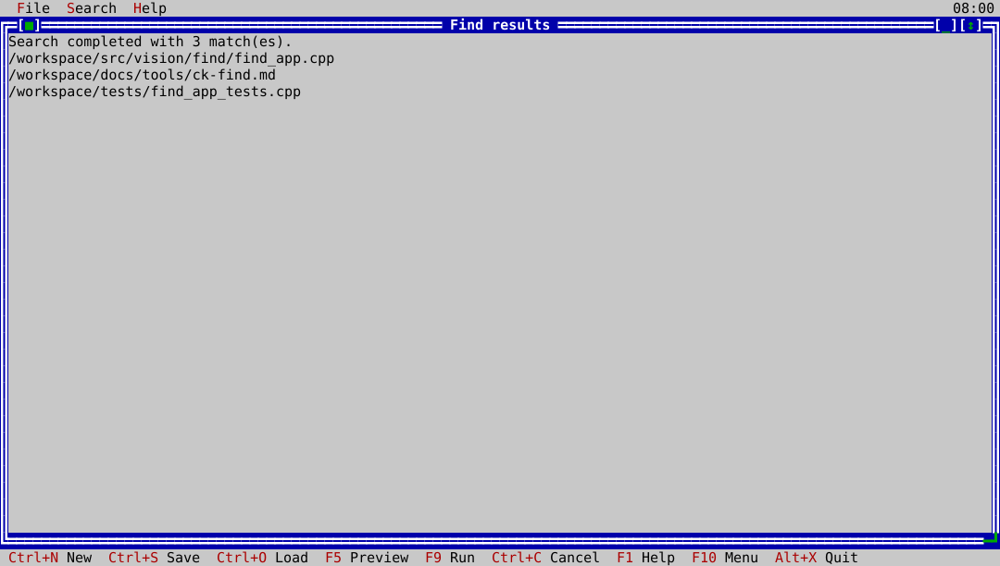

# ck-find

`ck-find` is the interactive ckVision file-search desktop utility. Launching
`ck-find` opens directly on the **Find Files** search prompt with focus in the
filename/pattern field: typing a pattern such as `*.txt` and pressing `Enter`
immediately starts a recursive search from the current directory, displays a
cancellable live **Search Progress** dialog, and opens a sortable **Found
Files** window on the MDI desktop.



## Usage

```bash
ck-find [DIRECTORY] [PATTERN]
```

Use `ck-find --help` for the command-line synopsis and `ck-find --version` for
package metadata. Optional positional arguments pre-populate the starting
directory and file pattern.

## Features

- **Zero-click launch to search**: Opens directly on `File name or pattern:` so
  typing `*.txt` (or a filename substring) and pressing `Enter` starts a
  recursive search immediately without extra setup dialogs.
- **Live search progress dialog**: Displays an animated progress bar, scanned
  entry and folder counters, live match count, active directory, and instant
  `Esc` / `Cancel` support.
- **Multiple Found Files windows**: Each completed search opens its own
  sortable MDI result window (`Name`, `Folder`, `Size`, `Modified`) with a live
  split-pane preview; tile, cascade, or switch across multiple searches from
  the `Window` menu.
- **Export result lists**: Export any Found Files window's sorted file list to
  a `.txt` file (`Ctrl+E` or `File → Export found files to text...`).
- **Integrated viewers & editors**: Preview and edit matched files directly on
  the `ck-find` desktop using ckVision and CK Utilities components — Text/Hex
  preview (`F3`), structured JSON Tree view & node editor, syntax-highlighted
  Text/Markdown/JSON editor (`F4`), and a 16-column virtualized Hex editor
  (`F8`) with fingerprint-checked atomic saves (`Ctrl+S`).
- **Advanced filters, presets & saved searches**: Filter by exclude globs, file
  type presets, modification date ranges, size bounds, symlink policy, and
  maximum folder depth (`F7`), or save/load reusable search specifications.
- **Power-user `Tools` menu**: Inspect and copy the equivalent POSIX `find(1)`
  command (`Ctrl+G`) or run explicitly confirmed bulk actions.

## Safe actions

Deleting an individual file from a Found Files window or running a bulk
specification action requires explicit confirmation and never deletes
directories. On macOS, `Tools → Bulk specification actions...` also supports
two fixed read-only sandboxed templates (`ckvision.file-info` and
`ckvision.sha256`) executed with direct `argv` under `/usr/bin/sandbox-exec`
(network and file writes denied, five-second timeout, 16 KiB per-file limit,
64-path cap) and displays the captured output in an audit report window.
