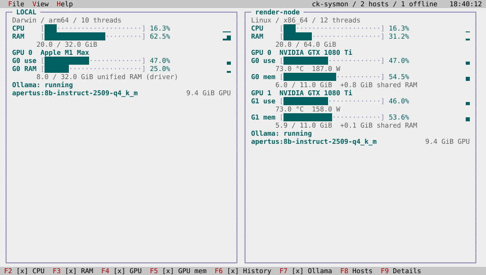

# ck-sysmon

`ck-sysmon` is a system monitor that draws resource charts directly on the
desktop background: CPU, memory, GPU load and memory, short histories, and the
models a local Ollama server has loaded. It watches the local machine and any
host you can reach by passwordless SSH, side by side.


## Usage

```sh
ck-sysmon                    # open the monitor
ck-sysmon --sample           # print one local sample and exit
ck-sysmon --sample-host NAME # print one sample from an SSH host and exit
ck-sysmon --help
ck-sysmon --version
```

The local machine starts selected and can be unchecked in View. With every
host unchecked, the desktop asks you to select one. The View menu lists the
concrete SSH destinations in your and the system's OpenSSH configuration,
including included files: `Host` entries and the literal names in `Match host`
and `Match originalhost`. Match conditions are not evaluated and no user
names are guessed; OpenSSH resolves authentication for each destination. A
host that connects without a password is selected by default; one that fails
stays in the menu, disabled and unchecked, with the reason. Your selections
survive refreshes and reconnection.

File / Exit closes the monitor, Help / About explains the display, and the
clock at the right of the menu bar drops down a calendar.

| Control | Effect |
|---|---|
| F2 / CPU | Toggle aggregate CPU utilization |
| F3 / RAM | Toggle occupied physical memory |
| F4 / GPU | Toggle GPU utilization, temperature and power |
| F5 / GPU memory | Toggle dedicated GPU memory and shared system RAM |
| F6 / History | Toggle the resource histories |
| F7 / Ollama | Toggle loaded Ollama models and their GPU allocations |
| F8 / Next hosts | Page through the selected hosts |
| F9 / Next details | Page through resource and model rows within each card |
| Ctrl+R / Refresh hosts | Recheck every discovered host now |
| Ctrl+D / Calendar | Open the menu-bar calendar from the keyboard |

The system line shows the logical processor (thread) count next to the
aggregate CPU bar; individual cores are not drawn.

The status-line toggles are clickable and show their state; the same commands
are under View / Metrics when the terminal is too narrow to show them all.
Every bar has a fixed 0–100% scale, and every history runs from oldest to
newest, keeping up to 60 samples. Histories count samples, not exact seconds:
the local machine is sampled once a second, remote hosts as fast as their
commands return. Unselected and unavailable hosts are rechecked every 15
seconds. A missing sample leaves a gap. Cards pick their column count from
the terminal width, then page hosts and details rather than silently dropping
a device. Ollama's model allocations come from its `size_vram` field; they are
part of GPU memory use, not an extra amount to add to it.

## Appearance and saved options

Standard (bright) is the default; View / Theme switches between Standard and
Dark, and the menus, calendar, and About box follow.




The application name, host count, and host page appear in the menu bar before
the clock and shorten when space is tight. Panels fill the space between the
menu bar and the status line, with no blank rows between stacked panels.


The theme, all six metric toggles, and which hosts are selected are saved after
every change and restored next time. A temporary SSH failure does not
overwrite a saved selection; new hosts start selected when reachable. The file
is written in one step with conflict detection, and an error appears on the
desktop instead of a preference being lost silently. No credentials,
measurements, or model names are stored.

| Platform | Settings file |
|---|---|
| macOS, Linux | `$XDG_CONFIG_HOME/ck-utilities/ck-sysmon.settings`, or `~/.config/ck-utilities/ck-sysmon.settings` |
| Windows | `%APPDATA%\ck-utilities\ck-sysmon.settings` |

Missing settings use the defaults. Invalid settings are reported and replaced
by the next change. A change made by another running copy is reported and
needs a restart to load. The `--sample` modes never touch the settings.

Earlier releases shipped `ck-sysmon` with ckVision, which kept the settings
in a `ckvision` folder (`~/Library/Application Support/ckvision` on macOS,
`~/.config/ckvision` on Linux, `%APPDATA%\ckvision` on Windows). Copy
`ck-sysmon.settings` from there into the folder above to keep them.

## Remote hosts

Nothing needs installing on a monitored host. OpenSSH uses the host's existing
user, port, identity file, jump host, and other settings. Connections run in
batch mode — no password prompt, strict host-key checking, no forwarding — with
bounded connect and idle timeouts. `ck-sysmon` never installs a helper,
accepts a host key, starts Ollama, or changes authentication. Wildcard `Host`
patterns are not destinations and are never expanded into guessed names.

If `ck-sysmon` is installed on the remote account's `PATH`, its own
`--sample` collector is used. Otherwise the monitor runs fixed, read-only
queries against the host's standard tools. Host names are passed as arguments,
never as script text. SSH work runs on two background workers and local
sampling on its own, so a slow host does not stall the local charts, menus,
or clock. A failed query clears that host's previous values instead of
showing stale ones; a host that answers in an unsupported way stays
selectable and says which metrics are unavailable.

| Host | Native collector | Fallback tools |
|---|---|---|
| Linux | `/proc/stat`, `/proc/meminfo`, DRM sysfs; optional NVML | `/proc`, `/sys`, awk, optional `nvidia-smi` and curl |
| macOS | Mach CPU and VM counters, sysctl, Metal identity, optional IOKit GPU counters | top, vm_stat, sysctl, optional curl |
| Windows | GetSystemTimes, GlobalMemoryStatusEx, DXGI, PDH; optional NVML | PowerShell CIM, optional `nvidia-smi` |

For a report without the interface, run `ck-sysmon --sample` locally or
`ck-sysmon --sample-host NAME` through exactly the same SSH path the desktop
uses. Both print the versioned collector format (`CKSYSMON 2`); GPU records
state whether their memory is dedicated or unified.

## GPU accounting

**Windows.** GPU memory comes from PDH's dedicated and shared usage counters.
DXGI and D3DKMT identify each physical adapter, including linked display
adapters, and PCI bus and address properties match NVML's utilization,
temperature, and power to the right device; identical card names and
enumeration order are never used as identity. PDH load is the busiest engine;
NVML's whole-device utilization is preferred when available.

**Apple unified memory.** Metal's registry ID selects the matching IOKit
accelerator. Its optional `Device Utilization %` and `In use system memory`
fields give GPU load and **unified RAM (driver)**, measured against physical
RAM. That memory is already part of the RAM chart: do not add the two.
These driver fields are not a stable Apple API, so missing or invalid values
stay unavailable; process-local Metal figures are never substituted, and no
private API is used.

**Linux AMD.** Busy, VRAM, and GTT counters depend on driver support.

**Raspberry Pi V3D.** On kernels that expose V3D `gpu_stats`, cumulative
counters for binning, rendering, texture formatting, and compute give each
engine's activity, and the bar shows the **busiest GPU engine** — the engines
overlap, so their percentages are never added. `bo_stats` gives **GPU buffers
(V3D)** in KiB: shared-memory buffer sizes, not dedicated VRAM, so no
percentage is shown and the value is not added to the RAM chart. Both are
readable without root on a Raspberry Pi 4 and a uConsole; where debugfs is
restricted the values stay unavailable, and `ck-sysmon` never mounts debugfs
or changes its access. See the
[Raspberry Pi interface guidance](https://github.com/raspberrypi/linux/issues/6517)
and the [Linux debugfs documentation](https://docs.kernel.org/filesystems/debugfs.html).


A missing driver, an unsupported device, or a failed query is never shown as
zero. At most 32 GPU devices or models and 512 SSH hosts are accepted, and a
report may be at most 32 KiB.

## Ollama

Ollama is asked on **127.0.0.1:11434 on the monitored host itself**, through
`/api/ps` — no port needs to be exposed or forwarded. The native collector
uses its own HTTP client (WinHTTP on Windows); the fallback uses curl or
PowerShell. A server with no models loaded is shown differently from an
unreachable server or an invalid answer.

## How it is tested

The sources are in `src/vision/sysmon`. `test_sysmon` covers CPU interval
accounting, unavailable values, host selection and recovery, device identity,
bounded histories, the wire and JSON formats, menus, toggles, paging,
resizing, the calendar, About, worker isolation, and shutdown. Eight checked-in
golden frames cover wide, ordinary, and small terminals, both themes, Apple
unified memory, Raspberry Pi V3D, stacked cards, and an empty host selection;
`generate_sysmon_goldens` regenerates them for review, and the screenshots on
this page are rendered from them. `test_sysmon_native` covers SSH
configuration discovery (Include files, quoted names, Match destinations,
duplicates, missing files) and settings storage, and `fuzz_sysmon` exercises
the wire and Ollama parsers.

Behavior is derived from published documentation:
[OpenSSH configuration](https://man.openbsd.org/ssh_config),
[Linux procfs](https://docs.kernel.org/filesystems/proc.html),
[AMD DRM sysfs](https://docs.kernel.org/gpu/amdgpu/driver-misc.html),
[Microsoft PDH](https://learn.microsoft.com/en-us/windows/win32/perfctrs/using-the-pdh-functions-to-consume-counter-data),
[NVIDIA NVML](https://docs.nvidia.com/deploy/nvml-api/latest/index.html), and
[Ollama's API specification](https://github.com/ollama/ollama/blob/main/docs/openapi.yaml).
