# ck-todo

`ck-todo` is a local Kanban board for the terminal: boards of lanes, two-row
task cards, full note windows, typed due dates, and a durable archive. Every
change is saved before the interface reports success, another running copy is
noticed, and conflicting edits are resolved without silently discarding either
version.

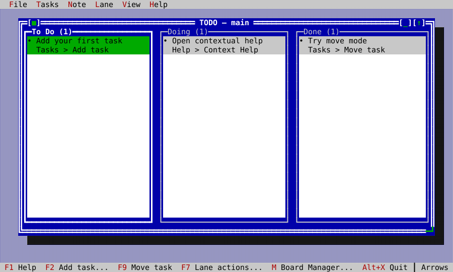

## Usage

```sh
ck-todo                      # open your workspace
ck-todo --demo               # a fixed in-memory tour that writes nothing
ck-todo --board Release      # open the board named Release (or: ck-todo Release)
ck-todo --data-dir PATH      # keep a workspace somewhere else
ck-todo --help
ck-todo --version
```

`--demo` is the safest first tour. Without it, `ck-todo` opens your workspace
in the CK Utilities settings folder:

| Platform | Workspace folder |
|---|---|
| macOS, Linux | `$XDG_CONFIG_HOME/ck-utilities/todo`, or `~/.config/ck-utilities/todo` |
| Windows | `%APPDATA%\ck-utilities\todo` |

On first launch, choose a guided sample or an empty board. A board named on
the command line is selected after loading; otherwise the last selected board
is restored. `--data-dir` keeps demonstrations and experiments apart from your
own tasks.

Earlier releases shipped this program as the ckVision example
`ckvision_todo`, which kept its workspace in `~/.ckvision/todo`. To keep those
tasks, copy that folder's contents into the workspace folder above before the
first start.

## Tasks and movement

Each task has a title, details, a long note, a due date with an optional due
time, a four-level priority, an optional named color, and its creator and
timestamps. Cards keep their height while the selection moves. Priority and
due state are shown with text and glyph shape as well as color, so the Mono
theme stays readable.

F2 adds a task and F3 edits every short field. The due date is a typed date
field: Left/Right selects year, month, or day, Up/Down changes it, and Delete
clears it. Space, or the dropdown arrow, opens a calendar to pick from. The
due time works the same way for hour and minute and is stored as 24-hour
`HH:MM`. Cards label overdue, today, and tomorrow, then fall back to the date,
and show the time when one is set.

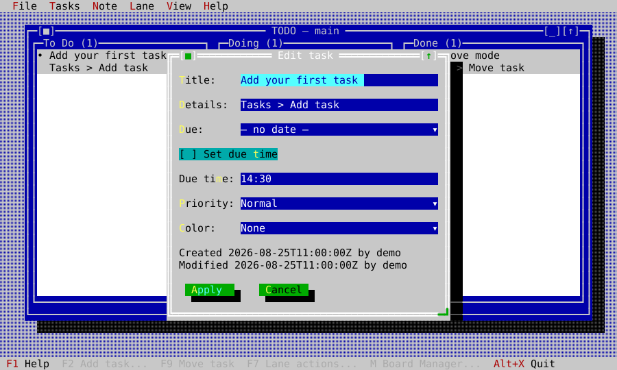

Archive and permanent Delete are deliberately different, and both show the
exact task before asking. Archive first writes a separate durable record and
only then removes the task; Delete removes it for good.

| Archive to the durable history | Delete permanently |
|---|---|
| 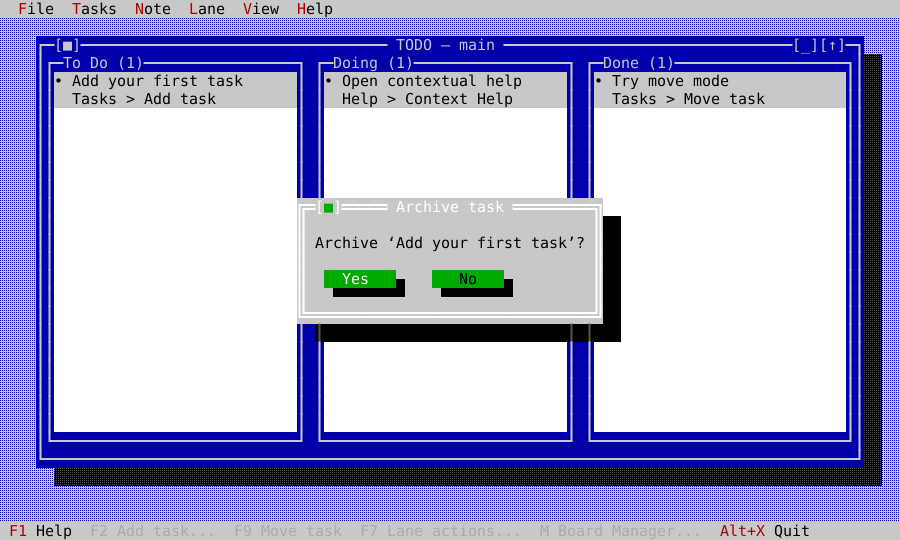 | 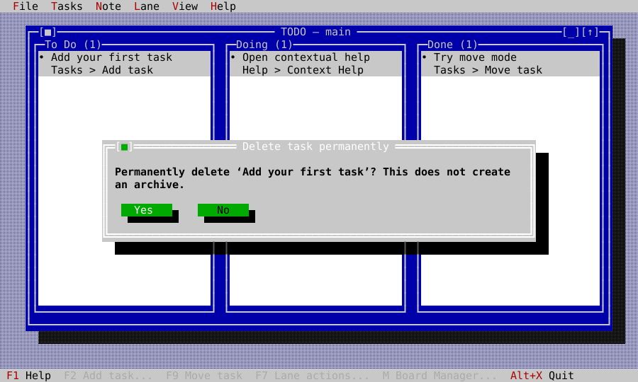 |

F9, Enter, or Space starts move mode. The arrow keys choose the target lane
and position; Enter or Space commits and Escape cancels. Dragging a card with
the mouse does the same, with the same visible insertion marker. A lane that
sorts automatically accepts tasks from other lanes but explains why it cannot
be reordered by hand.

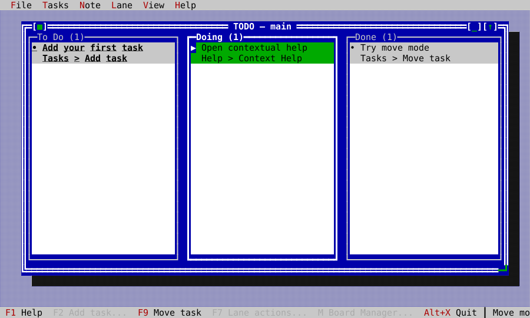

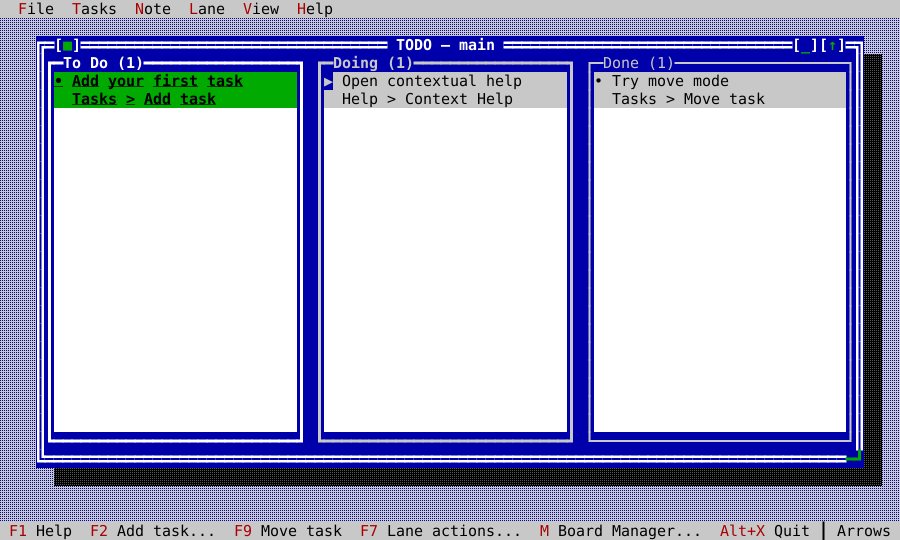

## Notes

F4 opens the selected task's note in its own movable, resizable editor window.
Several notes can be open over the board at once and take part in the usual
window commands: next, previous, list, tile, and cascade. The Note menu offers
undo, redo, cut, copy, paste, find, and word wrap; the window footer shows the
line, the column, and whether the note is saving or saved.

Edits are saved shortly after you stop typing, and when the window closes. If
another running copy changes the same note, your text stays visible until you
choose which version to keep. If the task is removed elsewhere, the note
becomes read-only but keeps your text so you can still copy it.

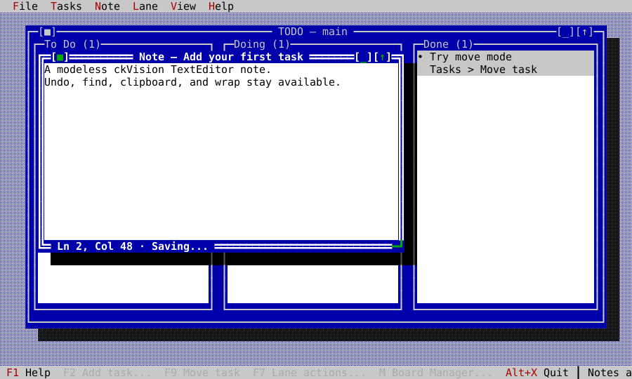

## Lanes and boards

F7 opens the lane actions. A lane can be renamed, colored, sorted (by hand,
color, due date, creation, modification, or priority), have a lane inserted on
either side, be merged into another lane, or be archived with all its tasks.
The last lane cannot be removed, and actions that cannot succeed are left out
of the list rather than failing afterwards.

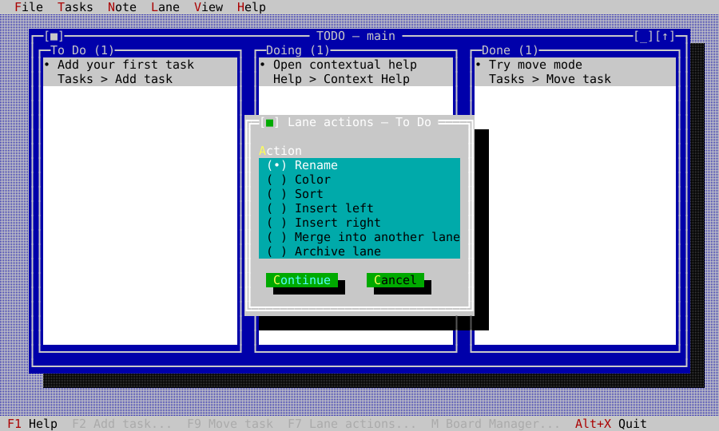

Press `m`, or click `Board: name` in the status line, for the Board Manager.
Boards can be created, switched, renamed, merged, or archived. Merging keeps
every task's identity, combines lanes with the same title, and appends the
rest. The protected `main` board means a workspace never has zero boards.

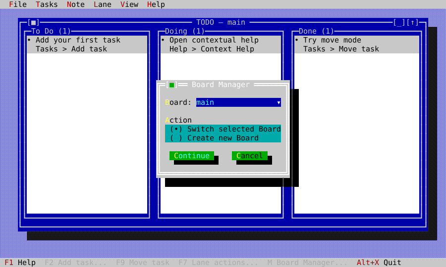

Many lanes stay readable instead of shrinking to slivers: the board scrolls
sideways, gives every lane a minimum width, and keeps the focused lane in
view.

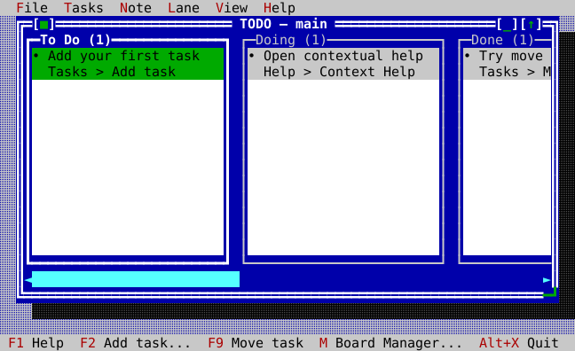

## Windows and themes

The board is an ordinary window: move, resize, zoom, minimize, cycle, list,
tile, and cascade all work. F10 or Alt with a menu letter opens the menus;
status-line commands can be clicked; task and lane context menus open with a
right-click, the Menu key, or Shift+F10.

The View menu switches the whole application between themes, and every state
stays distinguishable in each:

| Dark | Light |
|---|---|
| 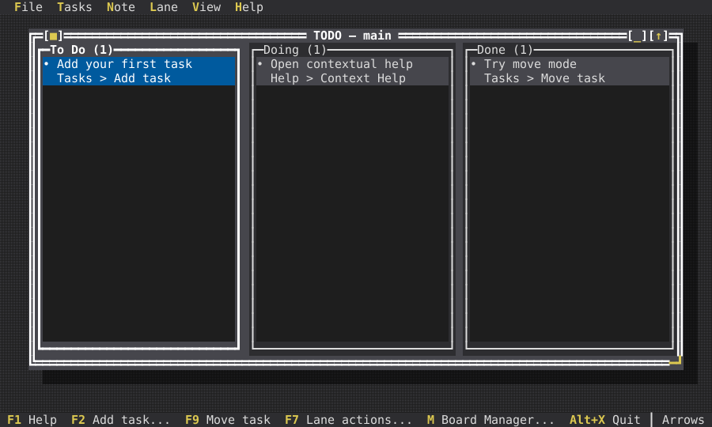 | 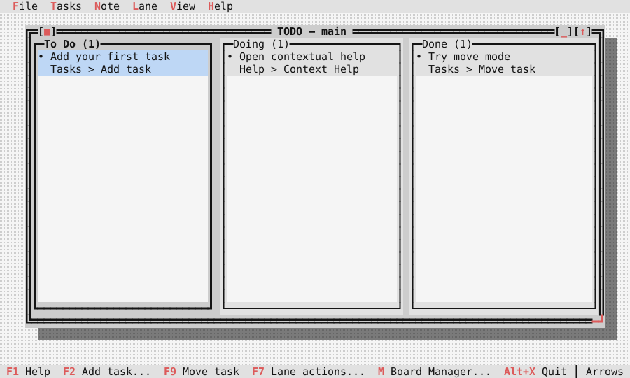 |

| Mono | High contrast |
|---|---|
| 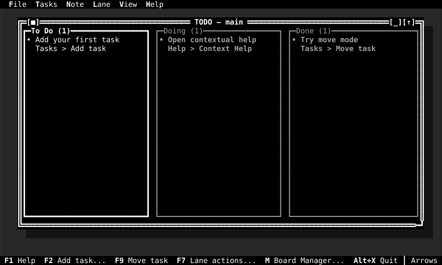 | 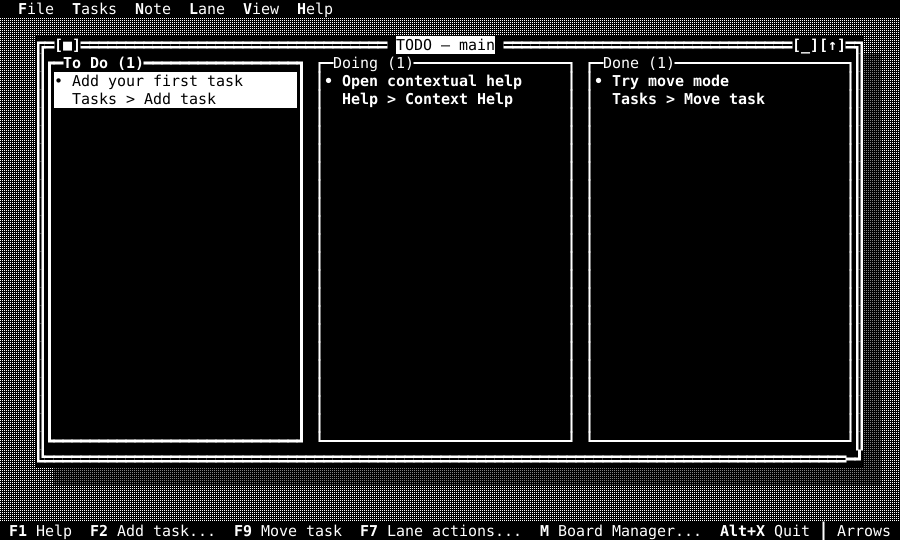 |

## Keys

Single-letter shortcuts work only on the board itself, so typing in a dialog
or a note never archives, moves, or quits. F1 opens help for whatever you are
doing.

| Intent | Keys |
|---|---|
| Context help | F1; on the board also `h` or `?` |
| Add / edit task | F2, Insert, or `+`; F3 or `e` |
| Open note | F4 or `n` |
| Lane actions | F7 |
| Archive / move | F8 or `a`; F9, Enter, or Space |
| Delete permanently | Delete or `d` |
| Select task / lane | Up/Down; Left/Right or Tab/Shift+Tab |
| Board Manager | `m` or the Board status item |
| Menu / zoom / next window | F10; F5; F6 |
| Cancel | Escape |
| Quit | Alt+X, or `q` on the board |
| Note undo / redo | Ctrl+Z / Ctrl+Y |
| Note cut / copy / paste | Ctrl+X / Ctrl+C / Ctrl+V |
| Note find / find next | Ctrl+F / Ctrl+G |
| Note word wrap | Alt+W |

Alt+X does not quit while a dialog is open, including the first-start welcome
dialog: answer or dismiss the dialog first.

## Saving, backups, and running two copies

The workspace is versioned, human-readable JSON in `todo.json`. Each save
writes a temporary file, flushes it, and replaces `todo.json` in one step, so
a crash never leaves a half-written workspace. Before the first change on a
calendar day, the previous workspace is copied to `backup/YYYY-MM-DD.json`;
that day's backup is never overwritten. Archived tasks are stored as separate
files under `archive/`, named by time and task id. If an archive cannot be
written, the task stays on the board.

Every second, `ck-todo` checks whether the workspace changed on disk. A clean
change from another copy is loaded and your selection is kept where possible.
A non-overlapping change of yours is reapplied on top. An overlapping change
waits until you choose to retry yours or keep the other version.

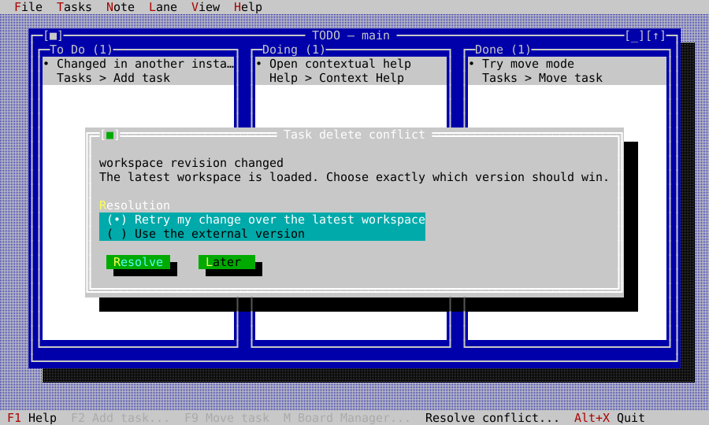

## How it is built

The program keeps domain rules, storage, interface, and host access apart, so
each part is tested on its own:

| Part | Responsibility |
|---|---|
| `todo_model` | tasks, lanes, boards, validation, sorting, moves |
| `todo_codec` | bounded JSON decoding and canonical encoding |
| `todo_repository` | the load, revision, commit, and archive contract |
| `memory_todo_repository` | demo mode, tests, screenshots, benchmarks |
| `json_todo_repository` | atomic files, daily backups, separate archives |
| `todo_controller` | timestamps, identity, and the durable change boundary |
| `todo_lane_view`, `todo_board_view` | cards, lanes, navigation, drag and drop |
| `todo_app` | commands, menus, dialogs, windows, help, themes, conflicts |
| `todo_host`, `main.cpp` | the command line, the user, the terminal, the real clock and files |

Every change is made on a candidate workspace and becomes current only after
storage accepts it at the expected revision; a rejected change leaves the
current workspace untouched. The sources are in `src/vision/todo`.

| Evidence | Coverage |
|---|---|
| `test_todo_model` | every task, lane, and board transition; validation, sorts, merges, archive plans |
| `test_todo_codec` | canonical round trips, hostile JSON and UTF-8, schema and size limits |
| `test_todo_repository`, `test_todo_repository_posix` | conflicts, backups, archive-first removal, real files, a real second process |
| `test_todo_controller` | timestamps, identity, durable outcomes |
| `test_todo_board` | navigation, responsive lanes, move and drag geometry, Unicode cards |
| `test_todo_smoke` | dialogs, commands, menus, themes, notes, mouse, conflicts, lifecycle |
| `test_todo_golden` | the pinned frames shown on this page |
| `fuzz_todo_codec` | empty, guided, Unicode, malformed, oversized, and future-schema input |
| `todo_bench` | a 1,000-task workspace against hard size, work, and redraw budgets |

The screenshots on this page and the golden frames are produced together from
the real program running on a headless terminal; see
[Building from source](../building.md#documentation-screenshots).

## Scope

`ck-todo` is a local tool, not a network service. It has no cloud sync,
reminders, recurrence, tags, global search, archive browsing, or import from
other applications.
