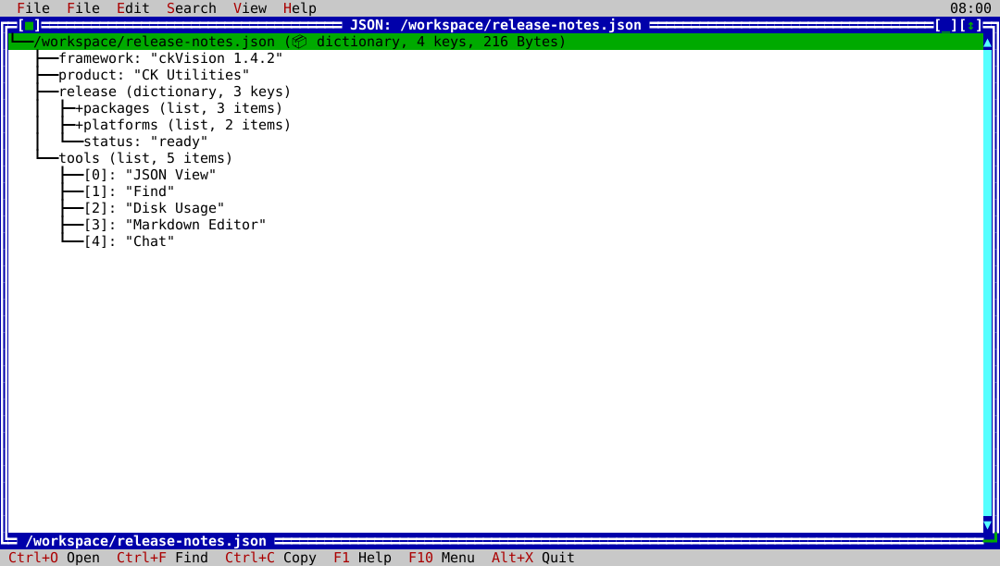

# ck-json-view

`ck-json-view` is the native ckVision JSON browser. It presents parsed JSON as
a navigable tree, with keyboard-first selection, expandable nodes, type-aware
previews, incremental search, and clipboard copy when the terminal supports
it.



## Usage

```text
ck-json-view [JSON_FILE ...]
```

Pass one or more JSON files to open them at startup. Without a path, choose
**File → Open JSON** in the native interface. Use `--help` (or `-h`) to show
the command-line usage, or `--version` to print package metadata without
opening a document.

## Features

- Open one or more JSON files at startup, or open, reload, and close documents
  from the native File menu.
- Parse JSON into a keyboard-navigable tree with expansion to a chosen level,
  stable selection, type-aware previews, and Unicode-safe display.
- Search text, move to the next or previous match, reveal matching ancestors,
  and end a search without losing the valid document.
- Copy the selected JSON value through the terminal clipboard protocol when
  the terminal supports it.
- Keep the last valid document visible when a reload is malformed or
  unreadable, and report the error in the interface rather than replacing it.
- Shared menus, help, themes, keyboard shortcuts, status feedback, and normal
  quit behavior.

## Native workflow

- **File:** open, reload, or close the active JSON document.
- **Edit:** copy the selected JSON value through the terminal clipboard.
- **Search:** find text, move to the next or previous result, or end a search.
- **View:** expand the tree to a chosen level.

Reload keeps the current valid document visible if the replacement file is
malformed. Search reveals and selects matching nodes, including Unicode text.

## Exit status

The interactive application exits through its standard quit command. Invalid
or unreadable documents are reported in the native interface without replacing
the currently valid document.
